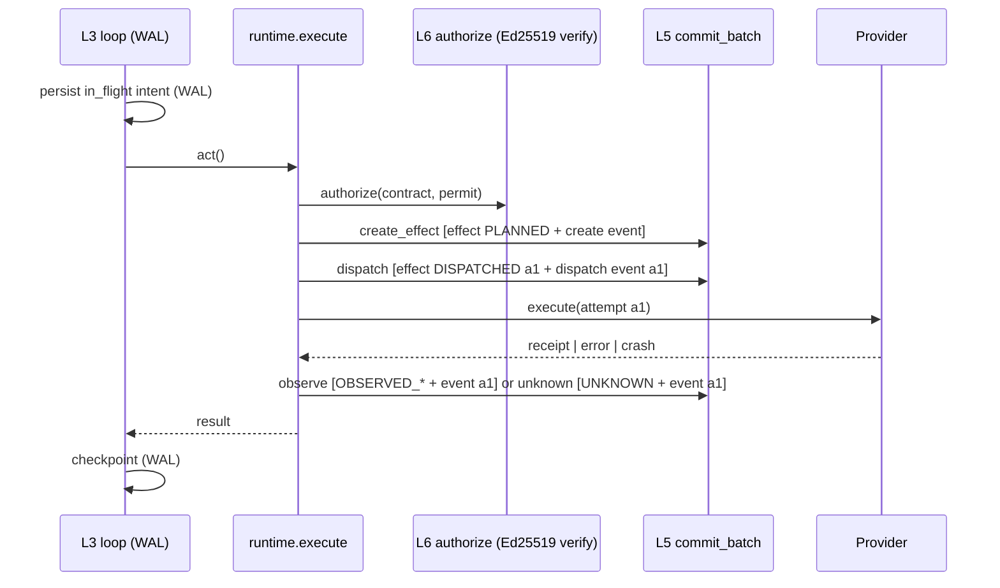

# L5 Durable Event Ledger — Contract (Phase 3)

Baseline: `d8de132` (PR #178). Labels: FACT (read in code), VERIFIED (reproduced/tested),
INFERRED, ASSUMPTION, UNKNOWN.

## 1. Audit baseline

| Store | Code | Role | Finding |
|---|---|---|---|
| Journaled batch commit | `core/mutation.py::commit_batch` / `_recover_pending_unlocked` | Single atomic multi-file commit engine (lock, staged fsync, journal, roll-forward) shared by authority, effects, domain state | **D-L5-1 VERIFIED**: a crash after the journal is durable but before an *existing* file is replaced makes recovery raise `StateConflictError` forever (it checks `dest` before `tmp`). **D-L5-2 VERIFIED**: the journal is written in place; a torn journal makes recovery raise `JSONDecodeError` forever. **D-L5-3 VERIFIED**: `commit_batch` does not recover pending batches first, so a precondition can read a half-applied batch (effect at v2 without its event). |
| Authority store | `core/authority_store.py` | Thin L5 seam over `commit_batch` for contracts/permits/attestations/effects | FACT: delegates; inherits D-L5-1..3. |
| Effect journal | `core/effect_authority.py` → `effects/<effect_id>.json` + `events/effect-*.json` | Effect state machine PLANNED→DISPATCHED→(UNKNOWN)→OBSERVED_*; record and event in one batch with CAS precondition | **D-L5-4 VERIFIED**: UNKNOWN/OBSERVED event path `effect-<id>-<STATE>.json` has no attempt, so attempt 2 overwrites attempt 1's event (history lost; not append-only). |
| WAL state store | `core/durable_wal.py`, `core/wal_state_store.py` | L3 loop state / governed memory; checksummed append-only WAL, process lock | FACT: separate store, separate transaction boundary. Not changed here. |
| L3 checkpoint | `core/durable_loop.py` (`in_flight_attempt` write-ahead intent) | Loop progress | **B-1 (architecture blocker, FACT)**: intent `effect_id`/`attempt_id` are random UUIDs minted by L3 (`"effect-" + uuid4`), not the L5 deterministic `effect_id = H(contract_id, logical_operation_id, actor)`. L3 cannot reconcile its intent against the L5 ledger. |
| Readers of `events/` | `core/reconcile.py`, `core/verification.py` | Filter `kind in {notice, mutation}` | FACT: no production reader consumes `external_effect` event filenames. |

## 2. Source of truth and transaction boundaries

| Record family | Source of truth | Transaction boundary |
|---|---|---|
| contract / permit / attestation | `authority/*` files | one `commit_batch` per record family write |
| effect current state | `effects/<effect_id>.json` (projection) | same batch as its event |
| effect history | `events/effect-*.json` (append-only, v2) | same batch as the projection; CAS on projection, create-only on event |
| L3 loop state | WAL store | separate; **no cross-store atomicity with L5** (FACT) |

No cross-store transaction is claimed. Cross-store consistency is by ordering + reconciliation:
L5 commit happens before provider I/O; L3 must reconcile against L5 after restart (B-1).

## 3. Contract

1. **Commit point.** A batch is committed iff `journal.json` exists in its batch dir. The journal
   is written to a temp file, fsynced, then atomically renamed (commit point), then the dir is fsynced.
2. **Roll-forward.** For each op: staged temp present → verify its digest, replace; else
   destination digest equals op digest → already applied; else → `StateConflictError` (fail closed).
3. **Uncommitted batches** (no journal, or unparseable legacy journal) are discarded. Legacy torn
   journals are safe to discard because the old engine fsynced the journal before any replace (FACT).
4. **Recover-before-commit.** `commit_batch` rolls forward pending batches under the lock before
   evaluating preconditions.
5. **Event identity (v2).** `event_id = "<effect_id>:<attempt>:<action>:<to_state>"`; fields
   `event_version: 2`, `event_id`, `attempt`. Paths include attempt; at most one event per
   (effect, attempt, transition) by the state machine.
6. **Append-only.** Every effect event is create-only (precondition: path absent). A duplicate is a
   `TransitionError`, never an overwrite. Idempotent `create_effect` returns the existing record.
7. **Ordering.** Per effect: `create` < `(dispatch a_n < [UNKNOWN a_n] < [OBSERVED a_n])` for n = 1..k.
8. **UNKNOWN.** Non-terminal; only `observe()` (authenticated receipt) or an explicitly authorized
   retry leaves it. Recovery never changes state; it only completes committed batches.
9. **Lineage.** contract → permit (L6 Ed25519 attestation) → effect (`contract_id`, `permit_id`) →
   dispatch event (`attempt_id`) → execute_attempt → receipt (bound to effect + attempt) → observe event.
10. **Ledger verification.** `verify_effect_ledger()` folds v2 events and requires them to match
    the projection; effects without v2 history report `LEGACY_UNVERIFIABLE`, never PASS.

## 4. Sequence

## 5. Failure matrix (dispatch path)

| # | Crash point | L5 state after restart | Provider called again? | Status |
|---|---|---|---|---|
| F1 | before commit point (staging written, journal not renamed) | unchanged (PLANNED / previous) — batch discarded | no call happened yet; a later dispatch is the first one | VERIFIED (test) |
| F2 | during commit (journal durable, some replaces done) | rolled forward: DISPATCHED + event | no: `execute()` refuses an existing effect | VERIFIED (test) |
| F3 | after DISPATCHED commit, during/after provider call, before receipt | DISPATCHED (ambiguous) | no: `execute()` refuses; only `resume_attempt` → `adapter.reconcile` (read-only) | VERIFIED (test) |
| F4 | after receipt commit (OBSERVED_*/UNKNOWN), before L3 checkpoint | OBSERVED_* / UNKNOWN | no | L5 VERIFIED; L3 completion **blocked by B-1** (loop goes BLOCKED or fails closed; it does not auto-complete) |
| F5 | torn journal | batch discarded | — | VERIFIED (test) |
| F6 | UNKNOWN at restart | UNKNOWN | no: retry needs explicit authorization; `execute()` refuses | VERIFIED (test) |

## 6. Blocker B-1 — options (not implemented; needs decision)

- **A (recommended):** L3 intent records `logical_operation_id`; the executor derives the L5
  `effect_id` deterministically before `act()`; on restart L3 reads the L5 effect and adopts
  OBSERVED_* receipts, keeps UNKNOWN/DISPATCHED blocked. Changes L3 intent schema (migration for
  persisted intents with random IDs → treat as legacy, block).
- **B:** L5 issues the identity (`create_effect` before the L3 intent) and L3 stores the returned
  `effect_id`. Requires an extra L5 call before ACT.
- **C:** keep as is: safe (no double dispatch) but F4 needs manual reconciliation.

## 7. Migration / compatibility

- Existing stores: legacy event files remain as history; new events use v2 names, so no collision.
- Legacy torn journals: discarded (see 3.3). Legacy valid journals: rolled forward by the new rule.
- Semantics change (explicit): duplicate effect events now raise instead of overwriting.
